<div align="center">

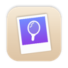

# Looking Glass

**A menu bar mirror for macOS that also takes polaroids.**

Check your hair before a call, pin a floating camera over a screen recording, or snap a framed, captioned photo, all from the menu bar.


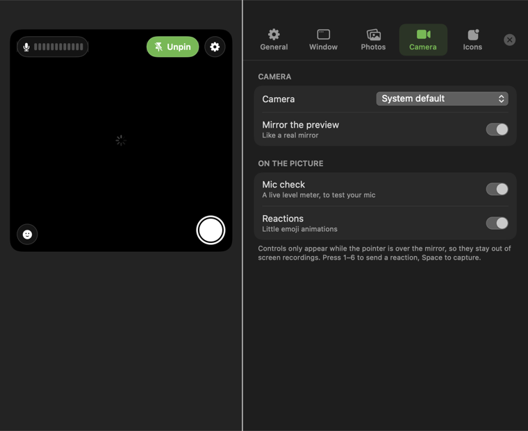

</div>

## Features

- **Menu bar mirror.** Click the icon and a live, mirrored camera opens in a speech-bubble popover.
- **Notch mode.** On notched MacBooks, hovering the notch grows the mirror out of it with a spring animation, like the Dynamic Island.
- **Pin it.** Pin lifts the mirror into a floating window that stays on top on every desktop. It remembers its position and resizes from any edge.
- **One window.** Settings open as a drawer inside the mirror window instead of a separate window.
- **Shapes.** Square, portrait, phone, landscape, wide, circle, or any custom shape, with transparency, zoom and rotation.
- **Polaroid camera.** Photos get a white, cream or black frame and one of seven caption styles. They can auto-save as PNG or JPEG, with a self-timer, shutter sound and screen flash.
- **Call-friendly extras.** A mic level meter and emoji reactions (keys 1–6) only appear while you hover, so they stay out of recordings.
- **Icons drawn in code.** The menu bar glyph and six alternate Dock icons are rendered in code. There are no image assets.

<div align="center">
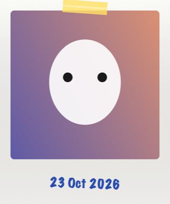
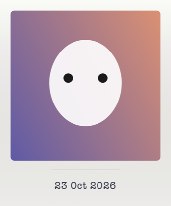
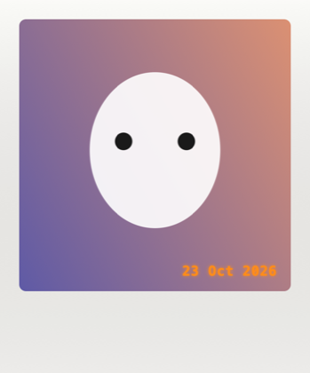
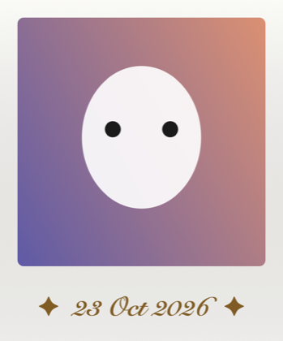
<br><sub>Caption presets: Scrapbook, Typewriter, Film stamp, Elegant (rendered by the offscreen self-test)</sub>
<br><br>
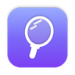 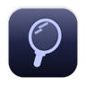 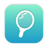 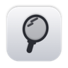  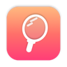
<br><sub>Alternate Dock icons</sub>
</div>

## Build & run

Requires macOS 14+ and Xcode 15+ (or the Swift 5.9 toolchain). It's a Swift package with no Xcode project.

```bash
./build.sh             # builds build/Looking Glass.app
./build.sh --install   # …and copies it to /Applications
open "build/Looking Glass.app"
```

Without a signing identity the app is signed ad-hoc, so macOS may ask for camera access again after each rebuild.

## How it's built

| File | Responsibility |
|---|---|
| `AppController` | Status item, popover, the single pop-out window and settings drawer, notch polling, photo pipeline |
| `Island` | The notch "Dynamic Island" window and its spring animation |
| `PanelRoot` | SwiftUI root of the pop-out window: mirror plus settings drawer |
| `MirrorView` / `CameraPreview` | Mirror UI. Zoom and rotation are applied to the `AVCaptureVideoPreviewLayer` |
| `PhotoComposer` | Applies the same crop, zoom, rotation and mask to the still, then draws the frame and caption |
| `IconRenderer` | Draws the menu bar glyph and all Dock/app icons in code |
| `DevTools` | `LookingGlass --selftest <dir>` renders sample photos, icons and every settings pane without a camera |

A few design choices:

- **Privacy:** the camera and mic only run while a mirror window is visible.
- **Testable UI:** the offscreen self-test renders every screen to PNG, so layout changes can be checked headlessly, even on a Mac without a camera. The images in this README come from it.
- **Not sandboxed,** so photos can be saved to any folder. The default is `~/Pictures/Looking Glass`.

## License

[MIT](LICENSE) © Kenneth Gomes
